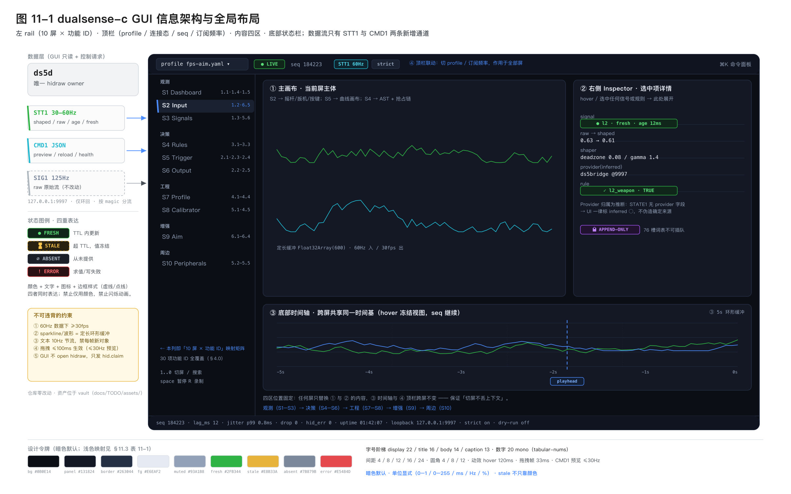
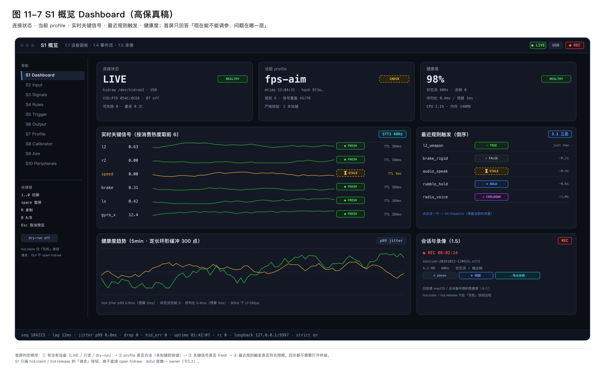
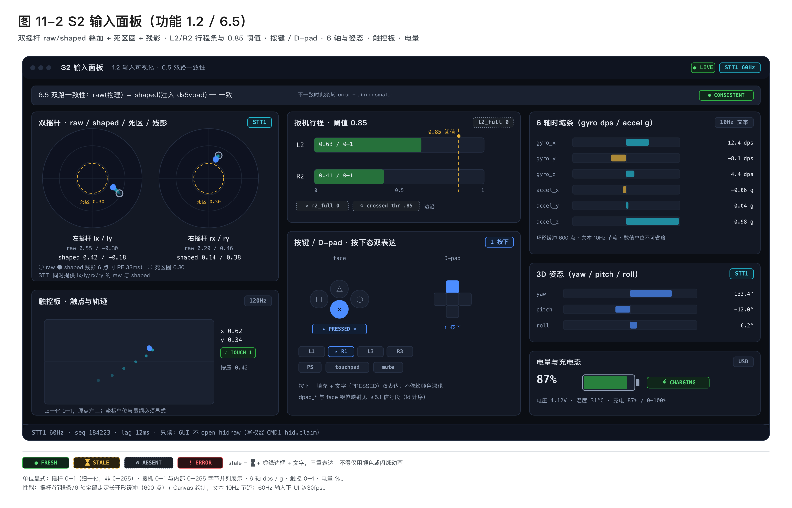
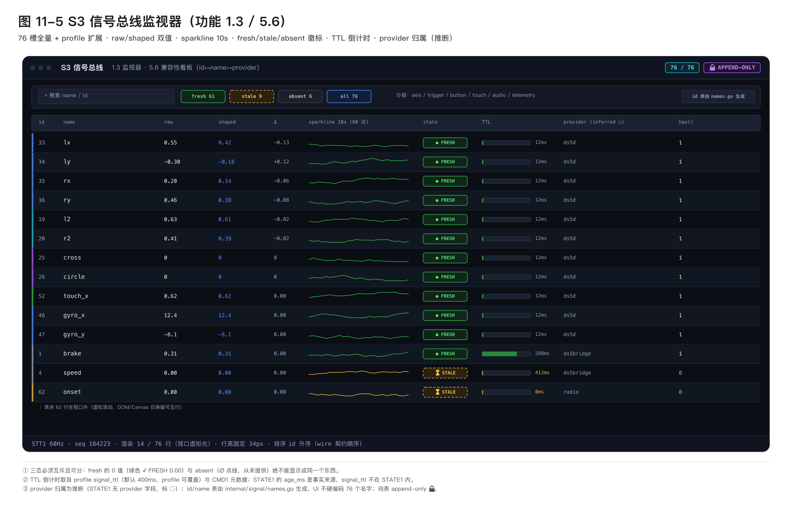
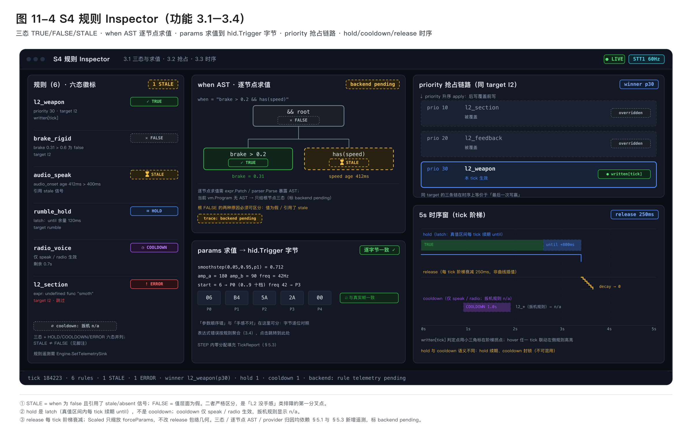
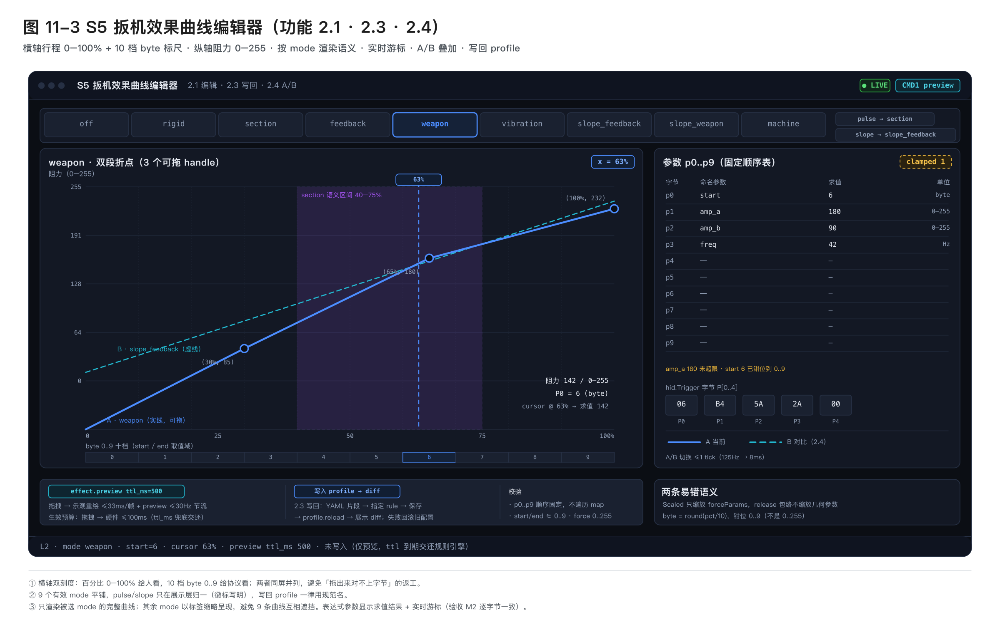
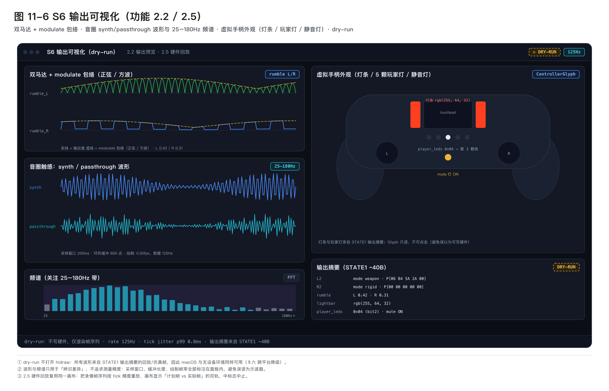

# dualsense-c GUI 客户端产品需求文档

> [!NOTE]
> **目标**
> 为 dualsense-c 新建一个图形客户端，把当前「改 YAML → 上机试手感 → 靠终端日志猜」的盲调闭环，替换为「看得见的数据流 + 可编辑的曲线 + 硬件回放」的闭环：输入、信号总线、规则决策、输出帧、扳机效果、Profile、遥测映射七个层面全部可视化并可交互，且不破坏既有 CLI / 守护进程契约。

> [!IMPORTANT]
> **当前代码基线（已逐条核对代码）**
> - 四层架构已就绪：`source` → `signal.Set`（每信号持有 raw / shaped / age）→ `rules.Engine.Step` → `sink.Run` + `hid.Frame`。
> - 信号词表 `signal.Standard` 共 **80** 个名字，`id 0..79`（末位 `r3`=79），wire 上是 `uint8` id，注释明确 **APPEND ONLY**；`ds5bridge.exe` 已按 id 部署，中间插入会静默错位。
> - 已有 IPC：`9997` 上 SIG1（`ver=1`，`magic u32 / ver u16 / count u16 / seq u32` 共 12B 头 + N×5B，条目按 id 升序，`ver!=1` 直接拒绝）与 SPK1（JSON 载荷）；`9998` 上 FFB1（12B）；`ds5radio` 独立占 UDP `9999`。
> - `signal.Set.Snapshot()` 只返回 shaped 值且 **直接丢弃 stale**；而 SIG1 广播的是 source 原始帧 `f.Values`（`cmd/ds5d/main.go:178`），既无 shaped、无 freshness，也无规则状态。
> - `rules.Engine` 每 tick 的决策过程（三态、params 求值、hold / cooldown、priority 抢占、release 衰减）全部是 `rule` 结构体的未导出字段，**无任何对外遥测**。
> - Profile 通过 `yaml.Unmarshal` 装载，**未开 `KnownFields`**，未知键静默丢弃（`profiles/fps-aim.yaml` 第 15–54 行的整个 `aim_assist` 块当前即为死配置）；`Source.Params` 是 `yaml:",inline"` 开放 map，严格模式也覆盖不到。
> - 热重载无通路：`shapers` 只在 `cmd/ds5d/main.go:75-88` 构建一次并传入 `sig.NewSet(shapers)`，`Engine` 只在 `rules.New` 时吃一次 `*Profile`。
> - `ds5ctl bench/watch/test` 会各自 open HID，与 `ds5d` 抢同一设备；`ds5d` 无热重载、无 rate 切换、无 health、无 JSON 输出。
> - 结论：GUI 的第一阶段瓶颈不在前端，而在于后端**缺少一条带 freshness 与规则状态的状态流**和**一条控制通道**。

## 〇、术语与优先级定义

| 术语 | 定义 |
|---|---|
| `raw` | source 直接产出的原始信号值，未经任何整形 |
| `shaped` | 经 `signal.Shaper`（deadzone / gamma / slew_up / slew_down）处理后的值，**规则实际看到的就是它** |
| `fresh` / `stale` | 信号是否在 `signal_ttl`（默认 400ms）内更新过；stale 值被 `Snapshot` 丢弃，`has()` 返回 0 |
| `signal.Standard` | 80 个标准信号名的有序词表（`id 0..79`），**APPEND ONLY**，是 ds5d / ds5bridge 之间的 wire 契约 |
| `STATE1` | 本 PRD 新增状态流（magic `STT1`）：shaped + raw + age + freshness + 规则三态 + 输出帧摘要 |
| `CMD1` | 本 PRD 新增控制面（magic `CMD1`）：热重载、效果预览、rate 切换、健康查询、离线试算 |
| `dry-run` | 不打开控制器，仅运行 source → Set → Engine 并输出帧的调试模式 |
| `P0` | 不做则对应里程碑不成立（阻塞评审/上线） |
| `P1` | 体验完整所必需，但可延后一个小版本 |
| `P2` | 周边子项目面板，按需实现 |

## 一、背景与问题

### 1.1 现状

dualsense-c 已能把游戏遥测 / 音频 / 虚拟手柄 FFB 转成 DualSense 自适应扳机与力反馈，profile 是纯 YAML 声明式（`rules[].when / params / value` + `expr-lang` 表达式）。但调参闭环仍是终端式的：

| 环节 | 现状手段 | 痛点 |
|---|---|---|
| 信号是否到达 | `ds5d -trace`（500ms 打一行文本） | 无法看历史；无法分辨「值就是 0」与「信号没来」（stale 被 `Snapshot` 直接丢弃） |
| 信号是否正确 | 肉眼比对终端数字 | 无 sparkline、无来源归属、无 TTL 倒计时 |
| 规则为什么没触发 | 无 | 表达式错误仅由 `reportErr` 在日志里聚合；`has()` 为 0 与 `when` 为 false 无法区分 |
| 扳机手感 | 改 YAML → 重启 ds5d → 上机 | 一次调参 30s 起，且「参数顺序错」与「手感不对」无法区分 |
| 参数语义 | `ds5ctl bench` 硬编码 8 条内置样例 | 无法试自己的参数、无法 A/B、无法写回 profile |
| 新游戏遥测映射 | `ds5ctl sniff` 打印十六进制 dump | 手数偏移、手填 `fmt`、反复试；`fields` decoder 的 `off / fmt / scale` 全靠猜 |
| 未知键 | 静默失效 | `aim_assist` 这类整块死配置（15–54 行）无任何报错，且该 profile 连 `shape:` 顶层块都没有 |
| 多进程 | 各自 flag | vpad / radio / bridge / haptics 的实际状态只能看终端 |

### 1.2 核心问题

**「手感」是高维、实时、难以言说的**，而当前唯一的表达与调试通道是「静态 YAML + 低频文本日志」。这导致调参迭代成本高、问题归因玄学、profile 里沉淀死配置，8 种扳机 mode × 命名参数的组合也难以被非作者使用。

### 1.3 为什么不是「给 CLI 套个壳」

CLI 输出是「某一瞬间的一行数字」，而调参需要的是**同一时刻的多层对齐**：raw 值 → shaped 值 → 表达式中间量 → 规则三态 → 输出帧 → 硬件表现。这要求后端先吐出结构化状态流（见 §五），GUI 才有意义。因此本项目本质是「新增一条可观测性与控制面」，而不是「封装命令行」。

## 二、目标与非目标

### 2.1 目标

1. **可视化即真相**：任一时刻，用户能在一个界面上同时看到输入、信号、规则决策、输出帧四层，并知道每个值的来源与新鲜度。
2. **把盲调变成可视化调参**：扳机效果曲线编辑器支持全部有效 mode 的可视化编辑、实时游标、A/B 对比、一键写入 profile 并热重载。
3. **让 profile 变可信**：表单⇄YAML 双栏、表达式校验与补全、未知键报错、保存即热重载并展示 diff。
4. **降低新游戏接入门槛**：遥测校准器把 sniff 升级为「变化字节高亮 + fmt 试算 + 拖拽映射 + 导出 fields YAML」。
5. **单进程 HID 所有权**：GUI 不做第二个 HID 打开者，全部经 `ds5d`，消除 bench / watch / daemon 抢设备问题。
6. **补齐已声明的体感增强能力**：`aim_assist`（摇杆曲线 + One-Euro 滤波 + 陀螺仪精瞄 + 反后坐力）从死配置升级为真实特性，并在 GUI 中可视化调参。

### 2.2 非目标

- 不做游戏内 overlay（DX / Vulkan 注入）；GUI 是独立窗口或浏览器页，不覆盖游戏画面。
- 不替代 `ds5ctl`：CLI 保留为 CI / 脚本 / 无头环境的一等公民，与 GUI 共享同一后端能力。
- 不做云端、多人协作、遥测上云；不做 profile 市场（仅本地目录 + 内置 profile）。
- 本期不在 macOS 上实现真实 HID（仅编辑 / dry-run / 回放 / 离线试算，见 §六）。
- 不做完整音频工作站；音频 AI 面板只做「事件时间轴 + 阈值 + 标签映射」的可视化。
- 不重构四层架构，不改动 `signal.Standard` 既有顺序（append-only 不可破坏）。
- 不做蓝牙链路的体验承诺（既有代码就位但未真机深入验证）。

## 三、用户画像与场景

| 画像 | 描述 | 核心诉求 |
|---|---|---|
| P1 作者/维护者 | 熟悉 Go 与 YAML，维护内置 profile | 快速定位「为什么这条规则没生效」，改参数立即上机 |
| P2 高级玩家/调参党 | 会改 YAML，但不懂 expr 细节 | 表单编辑、曲线拖拽、A/B 对比、一键写回 |
| P3 新游戏接入者 | 手上有 UDP 遥测，但不会写 `fields` | 校准器点选字节 → 试算 → 导出 YAML |
| P4 排障者（issue / CI） | 复现用户报告 | 打开 GUI 复现，导出「会话快照 + 状态流录像」 |

### 关键场景

1. **「L2 没手感」排障**：连上 → 输入面板看到 L2 行程正常 → 信号总线看到 `l2` fresh，但 `speed` stale（红色 + TTL 倒计时 0.4s）→ 立刻定位为遥测断流，而不是扳机配置。
2. **调 FPS 后坐力曲线**：曲线编辑器选 `weapon`，横轴 0–100% 行程、纵轴 0–255 阻力，拖三个折点成型 → dry-run 看输出波形 → 写入 profile 片段 → 热重载 → 实测，全程不重启进程。
3. **接入新赛车游戏**：打开遥测校准器 → 抓包 → 变化字节热力高亮 → 给 `off=116` 试算 `f32` 得 0.83，与踩油门同步 → 拖到 `throttle` → 导出 `fields` YAML → 写入 profile。
4. **规则不触发归因**：Inspector 中该规则显示 `FALSE`，展开看到 `when = "brake > 0.2 && has(speed)"`，`brake=0.31`（子表达式 TRUE）、`has(speed)=0`（子表达式 STALE）→ 一眼定位。
5. **profile 静默失效检查**：打开 `fps-aim.yaml`，表单立刻报「未知键 `aim_assist`」，并提示该块尚未实现（M6 交付后转为可编辑表单）。
6. **摇杆曲线对比**：M6 交付后，输入面板同时画「物理原始」与「曲线后」双摇杆，拖动 `exponent / mid_point` 时右侧残影实时变化，并可叠加 One-Euro 滤波前后的抖动轨迹。

## 四、功能需求

### 4.0 总览矩阵

| ID | 功能 | 优先级 | 里程碑 | 后端依赖状态 (详见 `backend-capabilities.md`) |
|---|---|---|---|---|
| 1.1 | 设备面板 | P0 | M1 | ✅ 已就绪 (§5.3 health) |
| 1.2 | 输入可视化 | P0 | M1 | ✅ 已就绪 (§5.1 STATE1) |
| 1.3 | 信号总线监视器 | P0 | M1 | ✅ 已就绪 (§5.1 STATE1) |
| 1.4 | 日志与事件流 | P0 | M1 | ✅ 已就绪 (无依赖) |
| 1.5 | 会话录像与回放 | P1 | M1 | ✅ 已就绪 (§5.1 STATE1) |
| 2.1 | 扳机效果曲线编辑器 | P0 | M2 | ✅ 已就绪 (§5.2 CMD1 preview) |
| 2.2 | dry-run 预览（输出波形 / 虚拟手柄） | P0 | M2 | ✅ 已就绪 (§5.1 + §5.2) |
| 2.3 | 一键写入 profile | P0 | M2 | ✅ 已就绪 (§5.2 + §5.5) |
| 2.4 | A/B 对比 | P1 | M2 | ✅ 已就绪 (§5.2 CMD1) |
| 2.5 | 硬件回放 | P1 | M2 | ✅ 已就绪 (§5.2 CMD1) |
| 3.1 | 规则 Inspector（三态 / 求值 / 字节） | P0 | M3 | ✅ 已就绪 (§5.1 规则段) |
| 3.2 | priority 抢占链路 | P0 | M3 | ✅ 已就绪 (§5.1 规则段) |
| 3.3 | 时序图（hold / cooldown / release） | P0 | M3 | ✅ 已就绪 (§5.1 规则段) |
| 3.4 | 错误聚合与跳转 | P1 | M3 | ✅ 已就绪 (§5.3) |
| 4.1 | 表单⇄YAML 双栏 | P0 | M4 | ✅ 已就绪 (§5.5) |
| 4.2 | KnownFields 严格校验 | P0 | M4 | ✅ 已就绪 (§5.3) |
| 4.3 | 表达式补全与校验 | P1 | M4 | ✅ 已就绪 (无依赖) |
| 4.4 | 热重载与 diff | P0 | M4 | ✅ 已就绪 (§5.5 SetShapers/Reload) |
| 4.5 | JSON 输出 | P1 | M4 | ✅ 已就绪 (ds5ctl -json) |
| 5.1 | 遥测校准器 | P1 | M5 | ✅ 已就绪 (§5.2 CMD1) |
| 5.2 | 音频 AI 面板 | P2 | M5 | ✅ 已就绪 (§5.2 CMD1) |
| 5.3 | 虚拟手柄 / FFB 面板 | P2 | M5 | ✅ 已就绪 (§5.2 CMD1) |
| 5.4 | Radio / 伴生语音面板 | P2 | M5 | ✅ 已就绪 (SPK1 / CMD1) |
| 5.5 | Bridge 面板 | P2 | M5 | ✅ 已就绪 (§5.2 CMD1) |
| 5.6 | 兼容性看板 | P2 | M5 | ✅ 已就绪 (无依赖) |
| 6.1 | 摇杆响应曲线（sigmoid / power / dual_zone） | P1 | M6 | ✅ 已就绪 (internal/aim) |
| 6.2 | One-Euro / EMA 滤波调参 | P1 | M6 | ✅ 已就绪 (internal/aim) |
| 6.3 | 陀螺仪精瞄映射 | P1 | M6 | ✅ 已就绪 (internal/aim) |
| 6.4 | 反后坐力（anti-recoil）调参 | P1 | M6 | ✅ 已就绪 (internal/aim) |
| 6.5 | 原始 vs 曲线后 双路一致性校验 | P1 | M6 | ✅ 已就绪 (internal/aim) |

### 4.1 M1 — 观测基础

| # | 功能 | 说明 | 优先级 |
|---|---|---|---|
| 1.1 | 设备面板 | 连接状态、hidraw 路径、USB / BT、VID:PID、实际输出速率、会话 uptime、重连次数、写失败计数；一键 claim / release、dry-run 切换 | P0 |
| 1.2 | 输入可视化 | 双摇杆（物理原始位置 + shaped 位置残影 + 死区圆）、L2 / R2 双色行程条 + 阈值线（`l2_full` / `r2_full` 固定 0.85，及自定义 `crossed` 阈值）、全部按键与 D-pad、6 轴（gyro / accel 时域条 + 3D 姿态小窗）、触控板坐标点、电量与充电态 | P0 |
| 1.3 | 信号总线监视器 | `signal.Standard` 全量 80 槽：名称与 id、raw / shaped 双值、sparkline（最近 10s）、fresh / stale 徽标、TTL 倒计时、来源归属、`has()` 结果；未提供者显示 `absent` 而非 0 | P0 |
| 1.4 | 日志与事件流 | 合并 ds5d 日志 + SPK1 语音事件 + 规则表达式错误，支持级别过滤与关键字搜索 | P0 |
| 1.5 | 会话录像 | 把 STATE1 流写入本地文件，支持暂停与拖动回放（服务 P4 排障，同时作为 M2 dry-run 与 macOS 无硬件环境的数据源） | P1 |

### 4.2 M2 — 调参与硬件回放

| # | 功能 | 说明 | 优先级 |
|---|---|---|---|
| 2.1 | 扳机效果曲线编辑器 | 全部有效 mode：`off` / `rigid` / `section` / `feedback` / `weapon` / `vibration` / `slope_feedback` / `slope_weapon` / `machine`，别名 `pulse`→`section`、`slope`→`slope_feedback` 归一展示；横轴行程 0–100%、纵轴阻力 0–255；按 mode 渲染语义（`section` 高亮区间、`weapon` 双段折点、`machine` 脉冲密度、`slope_*` 斜坡）；表达式参数显示求值结果 + 实时游标；保留 `p0..p9` 原始字节视图 | P0 |
| 2.2 | dry-run 预览 | 不碰硬件实时画输出帧：双马达 + `modulate` 正弦/方波波形；音圈触感 `synth` / `passthrough` 波形与频谱（关注 25–180Hz 带）；虚拟手柄外观（灯条色、5 颗玩家灯、静音灯） | P0 |
| 2.3 | 一键写入 profile | 曲线 → YAML 片段 → 插入指定 rule → 保存并触发热重载 → 展示 diff | P0 |
| 2.4 | A/B 对比 | 保存 A / B 两套参数，同屏叠加曲线与波形，可切换下发对比 | P1 |
| 2.5 | 硬件回放 | 精确复现某段录像帧序列到真实手柄（如「刚才那 2 秒」），带 tick 精度与中止 | P1 |

### 4.3 M3 — 决策可见

| # | 功能 | 说明 | 优先级 |
|---|---|---|---|
| 3.1 | 规则 Inspector | 每规则三态灯：`TRUE` / `FALSE` / `STALE`；`when` 表达式 AST 树 + 逐节点求值结果；`params` 每个表达式求值值 + 最终写入的 `hid.Trigger` 字节 | P0 |
| 3.2 | priority 抢占链路 | 引擎按 `priority` 升序 apply，同一 target 后写覆盖前写；展示被覆盖者与「本 tick 最终生效者」 | P0 |
| 3.3 | 时序图 | `hold` 余量、`cooldown` 倒计时、release 衰减包络（默认 250ms）实时曲线，叠加 `written` / `decay` 判定 | P0 |
| 3.4 | 错误聚合 | 按规则聚合表达式错误（当前仅日志聚合），点击跳转到对应 rule 双栏 | P1 |

### 4.4 M4 — Profile 工程化

| # | 功能 | 说明 | 优先级 |
|---|---|---|---|
| 4.1 | 表单⇄YAML 双栏 | 左表单右 YAML，双向同步，保存时 diff；支持新建 / 复制 / 删除 profile | P0 |
| 4.2 | 严格校验 | 后端开启 `yaml.Decoder.KnownFields(true)`，未知键作为可点击错误（首个目标：`fps-aim.yaml` 的 `aim_assist`）；范围限于顶层键与 rule 键，`Source.Params` 内为开放 map | P0 |
| 4.3 | 表达式补全与校验 | 补全信号名（`signal.Standard` + profile `signals`）与内置函数（`pressed` / `released` / `held` / `crossed` / `has` / `clamp` / `lerp` / `smoothstep` / `curve` / `scurve` / `sec` / `absf` / `sqrt` / `pow` / `ceil` / `floor` / `sin` / `cos`）；错误定位到行列 | P1 |
| 4.4 | 热重载与 diff | 保存即重载，展示「旧→新」生效差异与受影响规则；失败时回滚并保留上一次可用配置 | P0 |
| 4.5 | JSON 输出 | `ds5ctl` / `ds5d` 增加 `-json`（profile 列表、check 结果、信号快照、health），GUI 与脚本共用 | P1 |

### 4.5 M5 — 周边子项目面板

| # | 功能 | 说明 | 优先级 |
|---|---|---|---|
| 5.1 | 遥测校准器 | 抓包 → 字节变化高亮（diff / 热力）→ 选 `u8/s8/u16/s16/u32/s32/f32` 试算 → 拖拽映射到信号 → `scale / bias` → 导出 `fields` + `derived` YAML；导出前用物理量单调性做一致性提示 | P1 |
| 5.2 | 音频 AI 面板 | 事件时间轴（`surface_*` / `audio_*` / `onset`）、阈值与 hold 调参、标签映射只读表；未以 `-tags onnx` 构建时明确提示 | P2 |
| 5.3 | 虚拟手柄 / FFB 面板 | vpad 协议（`xinput` / `dinput8`）、grab 的 evdev 节点、FFB1 帧速率与左右马达波形（9998 或 unix socket） | P2 |
| 5.4 | Radio / 伴生语音面板 | 9999 decoder 选择（`auto` / `forza` / `outgauge` / `dirt` / `fields` / `acshm`）、persona、LLM endpoint 健康、SPK1 语音时间轴与 clip 试听 | P2 |
| 5.5 | Bridge 面板 | `ds5bridge.exe` layout（`ac` / `acc` / `acr`）、section、hz、事件阈值、跨进程可达性提示 | P2 |
| 5.6 | 兼容性看板 | `signal.Standard` 的 id↔name↔提供者↔消费规则 矩阵，标出 append-only 契约；profile 的信号覆盖度 | P2 |

### 4.6 M6 — 摇杆体感增强（原 `aim_assist` 死配置转正）

`profiles/fps-aim.yaml` 第 15–54 行的 `aim_assist` 块当前无任何 Go 侧消费者，是本 PRD 认定必须正视的能力缺口。现决定将其升级为正式需求。

| # | 功能 | 说明 | 优先级 |
|---|---|---|---|
| 6.1 | 摇杆响应曲线 | `linear` / `power(exponent)` / `sigmoid(exponent, mid_point)` / `dual_zone`；参数 `inner_deadzone`、`outer_boost`；GUI 在输入面板画「原始 vs 曲线后」双摇杆叠加，并提供曲线图与实时游标 | P1 |
| 6.2 | 抖动滤波 | `none` / `ema` / `one_euro(min_cutoff, beta, d_cutoff)`；GUI 画滤波前后轨迹与抖动谱，并显示引入的相位延迟估算 | P1 |
| 6.3 | 陀螺仪精瞄 | `trigger`（`l2_hold` / `touch` / `always`）、`trigger_threshold`、`natural_angle_deg`、`deadzone_dps`、`sens_yaw` / `sens_pitch`、`invert_pitch`；GUI 提供 3D 姿态 + 偏航/俯仰注入量仪表 | P1 |
| 6.4 | 反后坐力 | `trigger`（`r2_full` 边沿）、`start_delay`、`burst_force` / `burst_decay` / `sustain_force`、`jitter_noise`；GUI 画压枪力随连发次数的衰减曲线 | P1 |
| 6.5 | 双路一致性校验 | GUI 必须能同时显示「物理原始摇杆」与「实际注入游戏的摇杆」，并在两者不一致时给出显式告警（见 §5.6） | P1 |

> [!WARNING]
> **生效路径约束**
> 摇杆曲线只影响**游戏实际收到的输入**，而 `ds5d` 只写输出报告、不改变游戏读到的摇杆值。因此 M6 的真实生效路径是 `ds5vpad`（evdev grab → 虚拟手柄注入）；`ds5d` 侧必须读取同一份 profile 配置，才能把「曲线后」的值作为 shaped 值参与规则与 STATE1。两侧共用一套实现（`internal/aim`），否则会出现「GUI 显示已弯曲、游戏收到未弯曲」的静默错误。

## 五、关键技术约束与后端依赖

> [!WARNING]
> **不得改 SIG1 承载新字段**
> SIG1 是已部署的 wire 契约（`ds5bridge.exe`、`ds5radio` 均按 `ver=1` 解析）。所有新增状态一律走新 magic `STT1`，与 SIG1 并存于 9997 端口，按 magic 分流。同理 FFB1（9998）与 SPK1 帧格式不动。

### 5.1 STATE1 状态流（M1 / M3 阻塞项）

- **不能用现有 SIG1**：它广播 source 原始值，无 shaped、无 freshness、无规则状态（`cmd/ds5d/main.go:178`）。
- 新增 `signal.Set.Telemetry()`：导出每信号 `{raw, shaped, age, fresh, shaper}`。**不改 `Snapshot` 语义**（`Snapshot` 继续丢弃 stale 供规则使用）。
- **已冻结契约（已交付并在 dualsense-c 中实现，详细字节规约见 `backend-capabilities.md`）**：

```text
magic      "STT1" = 0x31545453   （与 FFB1 0x31424646 / SIG1 0x31474953 / SPK1 0x31505343 均不冲突）
端口       9997（与 SIG1 / CMD1 复用，按 magic 分流）
header     magic u32 | version u16 | flags u16(当前恒 0) | seq u32 | tick_ms u32 | signal_count u16 | rule_count u16
信号段     每项 11B：id u8 | shaped f32 | raw f32 | age_ms u16     （80 项 = 880B）
规则段     每项 13B：rule_id u16 | state u8 | priority i16 | last_fire_ms u32 | until_ms u32
          state: 0=FALSE 1=TRUE 2=HOLD 3=STALE 4=COOLDOWN 5=ERROR
输出摘要   ~40B：L2/R2 mode + p[0..3]、rumble L/R、lightbar RGB、player_leds、mute、
          haptic L/R、rate_hz、tick jitter、hid 错误数、subscribers
单帧预算   header 20B + 880B + 64×13B(832B) + 40B = 1772B（≈1.73KB，≤ 2KB 硬指标）
频率       30–60Hz（SIG1 保持 125Hz 原始流不变）
```

- 发送走既有 `broadcastRaw` 的「队列满即丢」语义，**绝不阻塞 125Hz 热路径**；丢帧计数进 health。
- `version` 字段必备，沿用 `ver != 1 拒绝` 的既有风格，为后续 TLV 扩展留位。

### 5.2 CMD1 控制面（M2 / M4 / M6 阻塞项）

现有 `ipc.Server` 只写不读（`acceptLoop` 只处理写队列），需增加读循环 + 帧解析：`magic "CMD1" = 0x31444D43 | len u32 | JSON payload`。

| 指令 | 语义 |
|---|---|
| `state.subscribe{rate}` | 协商 STATE1 推送频率（30 / 60Hz） |
| `profile.reload` | 从磁盘重读当前 profile 并热应用（失败回滚） |
| `profile.apply{patch}` | 局部补丁（单规则 / 单 shape 项），供曲线编辑器写回时做即时预览 |
| `effect.preview{mode, params, ttl_ms}` | 临时覆盖 L2/R2 效果，ttl 到期自动交还规则引擎 |
| `rate.set{hz}` | 切换 sink 出帧率 |
| `hid.claim` / `hid.release` | 显式申请 / 释放硬件写权，供 bench 类操作使用 |
| `rules.simulate{signals}` | 离线试算：喂一组信号，返回规则三态与输出帧，**不写硬件** |
| `health` | uptime、重连次数、写失败数、p99 tick jitter、STATE1 丢帧数、subscribers |

- **单进程 HID 所有权**：`ds5ctl bench/watch/test` 与 GUI 一律改为经 CMD1 请求 `ds5d` 代为写帧 / 读输入；`ds5d` 是唯一 hidraw owner。这是消除抢设备的唯一正解。
- **`rules.simulate` 不得污染真实状态**：必须基于引擎状态克隆执行，禁止推进真实的 `until` / `lastFired`，否则预览会改变真机行为。

### 5.3 其他后端缺口

| 缺口 | 对应 GUI | 建议 |
|---|---|---|
| 规则引擎零遥测 | 3.1 / 3.2 / 3.3 | `Engine` 增加 `SetTelemetrySink(func(TickReport))`，在 `Step` 内填充，零分配优先 |
| 无 JSON 输出 | 4.5 | `ds5ctl profiles/check` 与 health 增加 `-json` |
| 无 health | 1.1 | 走 CMD1 `health`，不用 HTTP |
| profile 无 KnownFields | 4.2 | `yaml.NewDecoder(f).KnownFields(true)`；限定顶层与 rule 键；提供 `-strict-profile` 过渡开关 |
| `ds5ctl` 无控制子命令 | 2.1 / 2.2 | `bench` / `watch` 改走 CMD1，行为向后兼容（flag 不变） |
| dry-run 只有文本帧 | 2.2 | `-dry-run` 同时输出结构化帧（或直接产出 STATE1） |

### 5.4 契约与兼容约束

- `signal.Standard` **append-only**：`id 0..79` 已占用，新增只能追加在末尾；兼容性看板（5.6）是这条契约的可视化载体。
- SIG1 `ver=1` / FFB1 12B / SPK1 帧格式全部不变；新流以新 magic 并存，旧 `ds5bridge.exe` 不受影响。
- 开启 `KnownFields` 属**行为变更**：存量未知键会从「静默失效」变为「启动失败」，必须在 CHANGELOG 明示，并给出迁移扫描脚本。
- 端口不可变：9997（SIG1 / STT1 / CMD1 复用）、9998（FFB1）、9999（radio UDP）。
- 仅监听 `127.0.0.1`；CMD1 不接受非环回来源。

### 5.5 profile 热重载的结构化改造（M2 / M4 阻塞项）

当前没有任何重载通路：`shapers` 只构建一次（`cmd/ds5d/main.go:75-88`），`Engine` 只吃一次 `*Profile`（`rules.New` 内部完成规则编译与 priority 排序）。需新增：

| 新增 API | 语义 |
|---|---|
| `signal.Set.SetShapers(map[string]Shaper)` | 替换整形参数，**保留已有信号历史与 age**，避免重载瞬间所有信号变 stale |
| `rules.Engine.Reload(p *profile.Profile)` | 重新编译规则并与旧集合按 `Name` 对齐：命中则保留 `until` / `lastFired` 计时，未命中则丢弃；新增规则从零计时 |
| `ds5d` 控制流 | 收到 `profile.reload` 后校验 → 构建新 shaper/engine → 成功后原子切换，失败保留旧配置并回 CMD1 错误 |

### 5.6 摇杆体感增强的后端依赖（M6 阻塞项）

| 依赖 | 内容 |
|---|---|
| 新包 `internal/aim` | `Curve`（linear / power / sigmoid / dual_zone）、`Filter`（none / ema / one_euro，需要 dt）、`GyroMapper`（自然倾角投影 + dps 死区 + 轴灵敏度）、`AntiRecoil`（击发边沿 + 爆发衰减 + 稳态 + 高斯抖动） |
| Profile schema | 新增 `aim:` 顶层块（沿用 `fps-aim.yaml` 现有字段名，`snake_case`），纳入严格校验 |
| 信号层 | `lx / ly / rx / ry` 的 shaped 值改为曲线后结果；raw 保留物理原始值，二者都进 STATE1 |
| 注入路径 | `ds5vpad` 的 evdev 读取 → 虚拟手柄写入之间插入 `aim` 链；与 `ds5d` 共用同一份实现与同一份 profile |
| 一致性 | 两进程各自持有 profile 副本时需版本戳（mtime + hash），不一致则 STATE1 报 `aim.mismatch`，GUI 显示告警 |
| 状态可见 | STATE1 输出摘要追加 `aim` 段（曲线类型、当前滤波 cutoffs、陀螺注入 yaw/pitch、反后坐力残余力） |

## 六、非功能需求

| 类型 | 要求 |
|---|---|
| 延迟 | 信号进入后端 → GUI 可见 ≤ 50ms（本地回环）；曲线拖拽 → 硬件生效 ≤ 100ms |
| 吞吐 | STATE1 在 60Hz + 80 信号 + 64 规则下单帧 ≤ 2KB（设计值 ≈1.73KB），序列化 ≤ 1ms，CPU ≤ 3%（相对 ds5d 单核） |
| 主循环隔离 | 遥测 / 序列化 / 网络写**不得**进入 125Hz tick 关键路径；沿用「队列满即丢」并提供丢帧计数 |
| GUI 性能 | 60Hz 数据下 UI ≥ 30fps（目标 60fps）；sparkline 与波形使用固定大小环形缓冲，禁止每帧大对象分配 |
| 启动 | 冷启动到可用 ≤ 2s；无设备时进入只读 / dry-run 模式并明确提示，不阻塞 |
| 资源 | GUI 常驻内存 ≤ 300MB；空闲 CPU ≤ 5% |
| 跨平台 | Linux 为一等公民（hidraw + PipeWire 音圈）；Windows 与 `ds5d.exe` 对等，至少支持只读面板 + 编辑；macOS 仅编辑 / dry-run / 回放 / `rules.simulate`，HID 相关控件标灰 |
| 构建 | 维持 `CGO_ENABLED=0` 交叉编译矩阵（`GOOS=linux/windows/darwin go build ./...`），`-tags onnx` 除外；前端资源经 `embed.FS` 打包，运行时不依赖 Node |
| 安全 | 仅监听 `127.0.0.1`；不写系统目录以外路径；profile 写入限定 profiles 目录 |
| 可维护性 | 复用既有 magic / version 约定；新增代码须通过 `gofmt` / `go vet` / `go test`（与 `.github/workflows/release.yml` 一致） |
| 可访问性 | 单位与量纲显式标注（0–1 / 0–255 / ms / Hz / %）；stale 状态不能只靠颜色，需附文字徽标 |

> [!NOTE]
> **技术选型（待评审）**
> - **方案 A：内嵌 SPA + 单二进制**（`cmd/ds5gui` 提供 HTTP/SSE，前端 `embed.FS` 内嵌）。零 CGO，符合现有交叉编译习惯，Windows 零运行时；桌面感较弱。
> - **方案 B：Wails**。桌面体验好，但 Linux 引入 webkit2gtk 与 CGO，与 `CGO_ENABLED=0` 矩阵冲突。
> - **方案 C：Tauri**。体验最好，但仓库引入 Rust 壳与第二套工具链，CI 成本上升。
> - 决策留待 M0（见 §八 开放问题 #2），本 PRD 不预设结论；三方案对 §五 的后端契约无影响。

## 七、验收标准

### M1

- [ ] 接入真实手柄后，双摇杆 / 扳机 / 按键 / 6 轴 / 触控 / 电量全部随物理操作实时变化，数值与 `ds5ctl watch` 一致（误差 ≤ 1 LSB）。
- [ ] 断开数据源（如停掉 `ds5bridge`），对应信号在 `signal_ttl`（默认 400ms）后 ≤ 100ms 内变红并显示 TTL 倒计时；`has()` 显示 0，而「值为 0 但 fresh」显示为绿色 0。
- [ ] 80 个标准信号全部出现在列表中，未提供者显示 `absent` 而非 0；profile `signals` 扩展名不在 STATE1 内，需单独标注。
- [ ] GUI 全程不打开 hidraw：`lsof` / `fuser` 验证唯一 owner 为 `ds5d`。

### M2

- [ ] `off` 与 8 个有效 mode 均可在编辑器调参并 dry-run 出可辨识波形；`pulse` / `slope` 别名正确归一。
- [ ] 表达式参数（如 `smoothstep(edge0, edge1, x)`）显示的求值结果与真实写入的 `hid.Trigger.P[]` 逐字节一致。
- [ ] 「写入 profile」产出的 YAML 可通过 `ds5ctl check`，且热重载后同一输入下输出帧字节与编辑器预览一致。
- [ ] A/B 切换在 ≤ 1 个输出 tick（125Hz 下 8ms）内完成。

### M3

- [ ] 每条规则三态与实际决策一一对应；构造 3 条同 target 不同 priority 的样例，GUI 正确标出最终生效者与被覆盖者。
- [ ] `hold` 余量、`cooldown` 倒计时、release 衰减（250ms）曲线与 `engine_test.go` 已知用例逐帧吻合。
- [ ] 表达式错误在 GUI 内 1 秒内可见并可跳转定位，不再需要看终端。

### M4

- [ ] 打开 `profiles/fps-aim.yaml` 时 `aim_assist`（15–54 行）被标为「未实现 / 未知键」，`shape:` 缺失也被提示。
- [ ] 表单⇄YAML 往返不丢信息（round-trip 字节级 diff 为空；注释保留需显式声明为已知限制）。
- [ ] 保存非法 profile 时热重载失败并自动回滚，旧行为继续生效，daemon 不退出。
- [ ] 严格校验仅覆盖顶层键与 rule 键：`Source.Params` 内的自定义键不被误报。

### M5

- [ ] 校准器能在 5 分钟内为一款未知游戏产出可用的 `fields` YAML，`ds5d` 加载后 `throttle` / `brake` / `speed` 与游戏内表现一致。
- [ ] 兼容性看板导出的 id↔name 表与 `signal.Standard` 完全一致（80 条，含顺序）。
- [ ] 音频 AI 面板在未启用 `-tags onnx` 的构建上给出明确原因，不显示空图。

### M6

- [ ] 四种曲线类型可调并可实时观察「原始 vs 曲线后」双摇杆；`inner_deadzone` / `outer_boost` 生效点可判定。
- [ ] One-Euro 与 EMA 的滤波轨迹、延迟估算与实测一致（阶跃响应上升时间误差 ≤ 15%）。
- [ ] 陀螺仪精瞄在 `l2_hold` / `touch` / `always` 三种触发方式下均按阈值启停，`invert_pitch` 与轴向灵敏度可判定。
- [ ] 反后坐力曲线的「前 `burst_decay` 衰减 + 稳态 `sustain_force`」与编辑器曲线逐点吻合。
- [ ] 双路一致性：篡改 `ds5vpad` 侧的 profile 副本后，STATE1 报 `aim.mismatch`，GUI 显示告警。

## 八、风险与开放问题

### 8.1 风险

| 风险 | 影响 | 概率 | 应对 |
|---|---|---|---|
| STATE1 载荷设计反复导致前端返工 | 高 | 中 | 先冻结 header + version 语义，信号段 / 规则段预留扩展位；M0 即落版本号 |
| 60Hz STATE1 与 125Hz tick 抢 CPU / GC | 高 | 中 | 复用缓冲、无分配序列化、独立 goroutine + 队列满即丢、压测门禁 |
| 开启 `KnownFields` 造成存量 profile 启动失败 | 中 | 高 | `-strict-profile` 过渡开关 + 迁移扫描脚本 + CHANGELOG 破坏性变更声明 |
| GUI 与 daemon 生命周期不一致（先开 GUI 后开 daemon） | 中 | 高 | 客户端自动重连 + 状态机（未连接 / 只读 / dry-run / 在线），断连不退出 |
| 校准器 `fmt` 猜错导致「看起来能用其实错位」 | 中 | 中 | 强制物理量单调性辅助校验，导出时附置信度提示 |
| mode 参数语义与真机不一致 | 中 | 中 | 编辑器显示命名语义但保留 `p0..p9` 原始视图；以 `bench` 回放作为真值校验 |
| `aim` 曲线在 ds5d 与 ds5vpad 双路实现漂移 | 高 | 中 | 单一 `internal/aim` 实现 + profile 版本戳 + STATE1 `aim.mismatch` 告警 |
| 跨平台前端分发成本 | 中 | 中 | 优先「浏览器 + 单二进制 HTTP 服务」，避开原生 webview 依赖 |
| macOS 无 HID 导致开发体验割裂 | 低 | 高 | 全面支持录像回放与 `rules.simulate`，无硬件也能完成大部分调参 |

### 8.2 开放问题（需决策）

| # | 问题 | 建议默认值 | 决策人 |
|---|---|---|---|
| 1 | GUI 仓库形态：同仓 `cmd/ds5gui` vs 独立仓库 | 同仓（复用 internal 包与 CI） | 作者 |
| 2 | 技术选型：内嵌 SPA vs Wails vs Tauri | 内嵌 SPA（零 CGO） | 作者 / TL |
| 3 | STATE1 默认频率 30Hz 还是 60Hz，是否允许订阅者协商 | 默认 30Hz，可协商至 60Hz | 评审 |
| 4 | CMD1 是否复用 9997 双向连接，还是独立端口 | 复用 9997，按 magic 分流 | 评审 |
| 5 | `aim_assist` 转正后是否保留原字段名 | 保留 `aim:` 命名并在 CHANGELOG 标记从「死配置」到「生效」 | 作者 |
| 6 | profile 写入是否需要 git 集成（自动 commit / diff） | 不需要，仅本地 diff 视图 | 作者 |
| 7 | 兼容性看板是否检测跨 profile 的 `signals` 自定义名冲突 | 需要，但放 P2 | 评审 |
| 8 | 排期是否按 1 人全职假设 | 需 TL 确认 | TL |

## 九、里程碑排期（建议）

| 里程碑 | 内容 | 后端前置 | 预估 | 目标日期 |
|---|---|---|---|---|
| M0 | 冻结 STATE1 / CMD1 契约；`cmd/ds5gui` 骨架 + embed 前端；单一 HID owner 改造设计；技术选型定案 | 契约文档 | 3d | 2026-10-31 |
| M1 | 设备面板 + 输入可视化 + 信号总线 + 日志 | `Set.Telemetry()`、ds5d 侧 shaped 广播、health | 10d | 2026-11-14 |
| M2 | 扳机曲线编辑器 + 输出波形 + dry-run + 写入 profile | CMD1（preview / apply）、bench / watch 改走 CMD1 | 12d | 2026-12-01 |
| M3 | 规则 Inspector + 时序 + 抢占链路 | STATE1 规则段、`Engine` telemetry sink | 10d | 2026-12-15 |
| M4 | Profile 表单编辑器 + 严格校验 + 热重载 diff + JSON | `KnownFields`、`Set.SetShapers` / `Engine.Reload`、CMD1 reload | 9d | 2026-12-29 |
| M5 | 校准器 / 音频 AI / vpad / radio / bridge / 兼容性看板 | CMD1 子项目只读接口、各进程 health | 12d | 2027-01-19 |
| M6 | 摇杆体感增强（曲线 / 滤波 / 陀螺 / 反后坐力 / 双路一致性） | `internal/aim`、`ds5vpad` 注入链改造、profile 版本戳 | 14d | 2027-02-09 |

> 排期假设 1 人全职。M1 与 M3 的 STATE1 需求可合并为「一次把状态流做够」：合并后 M1 +3d、M3 −3d。M6 与 M2 有交互（曲线编辑器与摇杆曲线是两套不同画布），可并行推进但需同一套实时数据源。

## 十一、UI 设计与线框图

> [!NOTE]
> **关于本章编号**
> 本章沿用「§〇 计入首节」的计数方式：§一–§九 既有编号、表格与结论一律不变，原附录顺延为 §十二。本章只新增设计资产与设计规范，不改写 §五 的任何契约字段，也不改动 §七 的验收项文案。

### 11.1 设计原则与编号说明

本章的图与规范服务于 §4.0 的 30 项功能，不新增需求、不删减需求。五条原则按优先级排列，冲突时上位覆盖下位：

1. **可视化即真相**：任一时刻必须能同时看到输入 → 信号 → 决策 → 输出四层，并且每个值都带「来源 + 新鲜度」。没有来源归属的数字不允许出现在界面上。
2. **四层对齐**：同一 tick 上，`raw` → `shaped` → 规则三态 → `hid.Frame` 必须能被纵向对照。这是 §1.3 判定「不是给 CLI 套壳」的硬标准。
3. **单位显式**：`0–1`（归一化）/ `0–255`（字节）/ `0..9`（十档）/ `ms` / `Hz` / `%` / `dps` / `g` 必须与数值同屏，禁止裸数字（§六 可访问性）。
4. **stale 不只靠颜色**：任何状态都用「颜色 + 文字徽标 + 图标 + 边框样式」四重表达，且禁止用闪烁动画表达 stale（§六 可访问性）。
5. **性能预算前置**：60Hz 数据下 UI ≥ 30fps、波形与 sparkline 一律定长环形缓冲、禁止每帧大对象分配（§六 吞吐 / GUI 性能）。

> [!WARNING]
> **本章的「设计态」与「契约态」**
> 线框图中出现的 `provider(inferred)`、TTL 倒计时、逐节点 AST、六态规则、`hid.claim` 按钮，均**依赖 §5.1 / §5.2 的新增契约**。当前基线尚未提供，因此图中一律用 `backend pending` / `inferred ○` 徽标标注，避免让读者误以为这些字段已经存在。

### 11.2 信息架构


<sub>图 11-1 全局信息架构与布局（源文件：[源文件 `dualsense-c-gui-01-ia.excalidraw`](assets/dualsense-c-gui/dualsense-c-gui-01-ia.excalidraw) · [SVG](assets/dualsense-c-gui/dualsense-c-gui-01-ia.svg)）</sub>

**左侧导航 rail（208px，常驻）** —— rail 同时充当「屏幕 ↔ 功能 ID」映射矩阵，分五组十项：

| 分组 | 屏幕 | 覆盖功能 ID |
|---|---|---|
| 观测 | S1 Dashboard / S2 Input / S3 Signals | 1.1·1.4·1.5 / 1.2·6.5 / 1.3·5.6 |
| 决策 | S4 Rules / S5 Trigger / S6 Output | 3.1–3.4 / 2.1·2.3·2.4 / 2.2·2.5 |
| 工程 | S7 Profile / S8 Calibrator | 4.1–4.5 / 5.1 |
| 增强 | S9 Aim | 6.1–6.4 |
| 周边 | S10 Peripherals | 5.2–5.5 |

**顶栏（48px）**：profile 选择器 → 连接态（`LIVE` / `READ-ONLY` / `DRY-RUN` / `RECONNECTING`）→ `STATE1 seq` → 订阅频率（30/60Hz）→ `⌘K` 命令面板。顶栏是**全局作用域**的唯一样式来源：切换 profile 或订阅频率会作用于所有屏。

**底部状态栏（28px）**：`seq · lag_ms · jitter p99 · drop · hid_err · uptime · loopback · strict`。它是「出问题时第一个该看的地方」，任何一屏都可见。

**内容四区（位置固定，切屏只换 ① 与 ②）**

| 区 | 职责 | 说明 |
|---|---|---|
| ① 主画布 | 当前屏主体 | S2 摇杆/扳机、S5 曲线、S4 AST + 抢占链 |
| ② Inspector | 选中项详情 | hover / 选中任何信号或规则即在此展开，**不跳屏** |
| ③ 时间轴 | 跨屏共享时间基 | 5s 环形缓冲；hover 冻结视图但 `seq` 继续推进 |
| ④ 顶栏联动 | 全局作用域 | profile / 订阅频率 / 严格模式 |

数据来源只有两条新增通道，加一条「不改动」的旧通道：

| 通道 | 频率 | 用途 | 约束 |
|---|---|---|---|
| `STT1` | 30–60Hz | shaped + raw + age + freshness + 规则段 + 输出摘要 | 单帧 ≈1.73KB（≤2KB），队列满即丢（§5.1） |
| `CMD1` | 事件驱动（JSON） | reload / preview / rate / hid.claim / simulate / health | 仅环回，不写硬件（§5.2） |
| `SIG1` | 125Hz | 仅用于 raw 对照 | **不改动**，`ver=1` 冻结（§5.4） |

### 11.3 栅格与设计令牌

**栅格**：12 列，`gutter 24px`，`margin 16px`；最小窗口 `1280×800`，设计基准 `1440×900`。`rail 208` + `topbar 48` + `statusbar 28` 为固定开销，主画布最小可用宽度 960px。

**表 11-1 设计令牌**（暗色默认；浅色映射只换底色与前景，语义色不变。表中数值与图表生成脚本 `_build_gui_diagrams.js` 的 `T` 常量逐值一致，改一处必须同步另一处。）

| 类别 | 令牌 | 值 | 用途与约束 |
|---|---|---|---|
| 画布 | `page` | `#ffffff` | 图外白底（PRD 页面为浅色，避免整屏发黑） |
| 画布 | `ink` / `inkMuted` / `inkFaint` | `#1e1e1e` / `#495057` / `#868e96` | 图外标题 / 图例 / 脚注文字 |
| 画布 | `hair` | `#DEE2E6` | 图外分隔线 |
| 底色 | `bg` | `#0B0E14` | 窗框内主背景（暗色默认） |
| 底色 | `bar` | `#0F1420` | 顶栏 / 状态栏 |
| 底色 | `panel` | `#131824` | 面板底 |
| 底色 | `panelAlt` | `#1A2130` | 次级块 / 表头 / 输入框 |
| 描边 | `border` | `#263044` | 1px 常规描边 |
| 描边 | `grid` | `#1E2636` | 网格与表格行线（弱于 border） |
| 前景 | `fg` / `muted` | `#E6EAF2` / `#93A1B8` | 主文本 / 次文本与单位 |
| 强调 | `accent` | `#4C8DFF` | 选中、游标、焦点、当前屏 |
| 语义 | `fresh` / `true` | `#2FB344`（底 `#10261A`，字 `#5BE07A`） | 新鲜 / 规则为真 |
| 语义 | `stale` | `#E8B33A`（底 `#2A2210`，字 `#F5C24B`） | 超 TTL / 值冻结 / 被钳位 |
| 语义 | `absent` / `false` | `#7B879B`（底 `#1B2028`，字 `#AEB8C6`） | 从未提供 / 规则为假 |
| 语义 | `error` | `#E5484D`（底 `#2A1214`，字 `#FF6B6F`） | 求值失败 / 写失败 / 断连 |
| 语义 | `hold` | `#4C8DFF`（底 `#111E33`，字 `#7FB0FF`） | hold 续期 / 时间轴播放头 |
| 语义 | `cooldown` | `#A855F7`（底 `#211230`，字 `#C084FC`） | cooldown / append-only 锁 |
| 语义 | `info` | `#22B8CF`（底 `#0E2530`，字 `#4DD4E8`） | 信息态 / 双值对照 |
| 字号 | `display` / `title` / `body` / `caption` / `micro` | 22 / 16 / 14 / 13 / 11 | 卡片大数 / 面板标题 / 正文 / 标签 / 角标 |
| 字体 | 数字 | `20 mono` | 一切数值列（`tabular-nums`，等宽保证不跳动） |
| 间距 | `gap` / `gutter` | 4·8·12·16·24 / 24 | 4 的倍数，禁止奇数间距 |
| 圆角 | `chip` / `panel` / `window` / `pill` | 4 / 8 / 12 / 999 | 徽标不圆角过大，避免与按钮混淆 |
| 动效 | `hover` | 120ms | 只变色不位移（避免抖动） |
| 动效 | `dragFrame` | 33ms | 拖拽乐观重绘帧预算（≈30fps 下限） |
| 动效 | `cmdRate` | ≤30Hz | CMD1 `effect.preview` 节流上限 |
| 动效 | `textRate` | 10Hz | 文本数值刷新节流（波形走 canvas 不节流） |
| 焦点 | `focusRing` | `2px #4C8DFF`，offset 2px | 键盘可见焦点的唯一表达（CSS 实现，非图表令牌） |
| 浅色映射 | `page` / `panel` / `fg` | `#ffffff` / `#f8f9fa` / `#1e1e1e` | 语义色与字号阶梯完全复用，只换底/前景 |

### 11.4 十屏线框布局要点

#### S1 概览 Dashboard（1.1 · 1.4 · 1.5）


<sub>图 11-7 S1 概览 Dashboard 高保真稿（源文件：[源文件 `dualsense-c-gui-07-dashboard.excalidraw`](assets/dualsense-c-gui/dualsense-c-gui-07-dashboard.excalidraw) · [SVG](assets/dualsense-c-gui/dualsense-c-gui-07-dashboard.svg)）</sub>

- **判定顺序即布局顺序**：① 有没有设备 → ② profile 是否合法 → ③ 关键信号是否 fresh → ④ 最近规则触发是否符合预期，四步都不需要开终端。
- **连接状态卡**：hidraw 路径、USB/BT、VID:PID、实际出帧率、uptime、重连次数、写失败计数；只画 `hid.claim` / `hid.release` 的**请求按钮**，GUI 不 open hidraw（§5.2 单进程 HID 所有权）。
- **当前 profile 卡**：文件名、`mtime + hash`、规则数、信号覆盖度、严格校验结果（未知键即红并可点击跳 S7）。
- **实时关键信号**：按消费热度取前 6，每行 `shaped` 主值 + sparkline + `StateChip` + TTL 余量，`raw` 悬停展开（图 11-7 为空间受限的单值形态）。
- **最近规则触发**：倒序 5 条，点击跳 S4 并保留当前时间基（不重置 hover / 播放头）。
- **健康度**：tick jitter p99、STATE1 丢帧、序列化耗时、CPU/内存，5min 趋势 + 会话录像状态。
- 数据源：`STT1 30–60Hz` + `CMD1 health`；`SIG1` 仅用于 raw 对照。

#### S2 输入面板（1.2 · 6.5）


<sub>图 11-2 S2 输入面板（源文件：[源文件 `dualsense-c-gui-02-input.excalidraw`](assets/dualsense-c-gui/dualsense-c-gui-02-input.excalidraw) · [SVG](assets/dualsense-c-gui/dualsense-c-gui-02-input.svg)）</sub>

- **双摇杆**：`raw` 空心圈 + `shaped` 实心点 + 6 点残影（LPF 33ms）+ 死区圆（虚线，0.30）；读数 `raw` 与 `shaped` 两行并列，不合并显示。
- **L2 / R2**：0–1 归一化行程条 + 固定 `0.85` 阈值线（`l2_full` / `r2_full`）+ 自定义 `crossed` 阈值；`crossed` 是**边沿**（上次 < 阈值且本次 ≥ 阈值），不是电平。条内同时显示内部 0–255 字节，避免「归一化看着对、字节对不上」。
- **按键 / D-pad / 肩键**：按下态 = 填充 + `PRESSED` 文字，双表达。
- **6 轴**：`gyro dps` / `accel g` 时域条 + yaw / pitch / roll 姿态条，单位随数值。
- **触控板 + 电量**：触点坐标（0–1，原点左上）与轨迹、电量 `%` 与充电态文字。
- **6.5 一致性横幅**：同时显示「物理原始摇杆」与「实际注入 `ds5vpad` 的摇杆」，不一致时转 `ERROR` 并联动 `aim.mismatch` 告警。
- 数据源：`STT1`（`lx/ly/rx/ry` 的 raw + shaped 双值）。

#### S3 信号总线监视器（1.3 · 5.6）


<sub>图 11-5 S3 信号总线（源文件：[源文件 `dualsense-c-gui-05-signals.excalidraw`](assets/dualsense-c-gui/dualsense-c-gui-05-signals.excalidraw) · [SVG](assets/dualsense-c-gui/dualsense-c-gui-05-signals.svg)）</sub>

- 80 槽全量；按 `id` 升序（wire 契约顺序）。`id ↔ name` 表由 `internal/signal/names.go` 生成，UI 不硬编码 80 个名字。profile `signals` 扩展名不出现在 STATE1 中。
- 列：`id | name | raw | shaped | Δ | sparkline 10s | StateChip | TTL | provider(inferred ○) | has()`。
- 过滤 `fresh / stale / absent / all` + 关键字搜索；表体虚拟化，仅渲染视口行（行高固定 34px）。
- `TTL` 条：来源是 profile 的 `signal_ttl`（默认 400ms，**profile 可覆盖**，属客户端参数）；`signal_ttl` 不在 STATE1 内，CMD1 也不返回它，STATE1 只给 `age_ms` 这一事实值。
- 常驻 `APPEND-ONLY 🔒` 徽标；5.6 兼容性看板复用同一 id 表，不另建一份。
- 数据源：`STT1`；`provider` 为**推断**（STATE1 无 provider 字段）。

#### S4 规则 Inspector（3.1 · 3.2 · 3.3 · 3.4）


<sub>图 11-4 S4 规则 Inspector（源文件：[源文件 `dualsense-c-gui-04-rules.excalidraw`](assets/dualsense-c-gui/dualsense-c-gui-04-rules.excalidraw) · [SVG](assets/dualsense-c-gui/dualsense-c-gui-04-rules.svg)）</sub>

- **规则列表六态徽标**：`TRUE` / `FALSE` / `STALE` + `HOLD` / `COOLDOWN` / `ERROR`。`HOLD` 显示 `until` 余量；`COOLDOWN` 仅 `speak` / `radio` 生效，**扳机规则显示 `n/a`**。
- **when AST 逐节点求值**：`brake > 0.2` 为 TRUE（`brake=0.31`）、`has(speed)` 为 STALE、根 `&&` 为 FALSE。逐节点需要 `expr.Patch` / `parser.Parse` 暴露 AST，而当前 `vm.Program` 无 AST → 标 `backend pending`，先只给根节点三态。
- **params 求值 → 字节**：每个表达式求值结果 + 最终 `hid.Trigger` 的 `P[0..4]`，逐字节对照。「参数顺序错」与「手感不对」在这里可分。
- **priority 抢占链路**：按 `priority` 升序 apply，同 target 后写覆盖前写；标出 winner、被覆盖者与 `written[tick]`。
- **5s 时序窗**：`hold` 为「真值区间 + `until` 延伸」的阶梯（**latch，每 tick 续期，不是 cooldown**）；`release` 从首个 inactive tick 满值起**每 tick 阶梯衰减** 250ms；`cooldown` 仅 speech/radio 行出现。
- 数据源：`STT1` 规则段（`Engine.SetTelemetrySink`，§5.3 待实现）。

#### S5 扳机效果曲线编辑器（2.1 · 2.3 · 2.4）


<sub>图 11-3 S5 扳机曲线编辑器（源文件：[源文件 `dualsense-c-gui-03-trigger.excalidraw`](assets/dualsense-c-gui/dualsense-c-gui-03-trigger.excalidraw) · [SVG](assets/dualsense-c-gui/dualsense-c-gui-03-trigger.svg)）</sub>

- 9 个有效 mode 平铺：`off / rigid / section / feedback / weapon / vibration / slope_feedback / slope_weapon / machine`，别名 `pulse → section`、`slope → slope_feedback` **只在展示层归一**（徽标写明），写回 profile 一律用规范名。
- **双刻度横轴**：上轴 0–100% 行程给人看，下轴 10 档 `byte 0..9` 给协议看。`byte = round(pct / 10)` 且**钳位 0..9**；`start/end` 取值域是 `0..9`，而 `force / strength / amp` 才是 `0..255`。两套刻度同屏，避免「拖出来对不上字节」的返工。
- 纵轴阻力 `0–255`；按 mode 渲染语义：`section` 高亮区间、`weapon` 双段折点、`machine` 脉冲密度、`slope_*` 斜坡。只渲染被选 mode 的完整曲线，其余以标签缩略，避免 9 条曲线互相遮挡。
- **实时游标** + 求值读数；右侧 `p0..p9` **固定顺序表，不遍历 map**，表达式参数显示求值结果。
- **A/B 叠加**：A 实线、B 虚线；A/B 切换 ≤ 1 个输出 tick（125Hz → 8ms）。
- **写回**：YAML 片段 → 指定 rule → 保存 → `profile.reload` → 展示 diff，失败回滚保留旧配置。`Scaled` 只缩放 `forceParams`，**release 包络不缩放几何参数**。
- 数据源：`CMD1 effect.preview{ttl_ms}` / `profile.apply`；`STT1` 提供 L2/R2 实时游标。

#### S6 输出可视化（2.2 · 2.5）


<sub>图 11-6 S6 输出可视化（源文件：[源文件 `dualsense-c-gui-06-output.excalidraw`](assets/dualsense-c-gui/dualsense-c-gui-06-output.excalidraw) · [SVG](assets/dualsense-c-gui/dualsense-c-gui-06-output.svg)）</sub>

- 双马达 + `modulate` 包络（正弦 / 方波）波形，L/R 分道。
- 音圈 `synth` / `passthrough` 双波形 + 25–180Hz 频谱窗；采样窗口、缓冲长度、绘制帧率全部标在面板内，避免被误读为测量仪器。
- `ControllerGlyph`：灯条 RGB 色块、5 颗玩家灯（bit 图，`0x04` → 第 3 颗）、静音灯；只读，不可点击（避免误以为可写硬件）。
- `DRY-RUN` 徽标常驻：不写硬件，波形来自 STATE1 输出摘要的回放/仿真帧，因此 macOS 与无设备环境同样可用（§六 跨平台降级）。
- 2.5 硬件回放复用同一画布，显示「计划帧 vs 实际帧」双轨，可中途中止。
- 数据源：`STT1` 输出摘要（≈40B）+ 录像回放；不新增通道。

#### S7 Profile 编辑器（4.1 – 4.5）

- 左表单 / 右 YAML 双栏，双向同步，保存前 diff；支持新建 / 复制 / 删除。
- **未知键报错可点击**（首个目标：`profiles/fps-aim.yaml` 第 15–54 行的 `aim_assist` 整块，且该文件连 `shape:` 顶层块都缺失）；`Source.Params` 为 `yaml:",inline"` 开放 map，严格模式不得误报。
- 表达式补全：`signal.Standard` + profile `signals` + 18 个内置函数（`pressed / released / held / crossed / has / clamp / lerp / smoothstep / curve / scurve / sec / absf / sqrt / pow / ceil / floor / sin / cos`，另有 expr-lang 自带的 `min / max / round`），错误定位到行列。
- 热重载 diff：旧 → 新生效差异 + 受影响规则；失败自动回滚，daemon 不退出。
- 数据源：`CMD1 profile.reload` / `profile.apply` + 本地文件（写入限定 profiles 目录）。

#### S8 遥测校准器（5.1）

- 抓包十六进制网格，**变化字节高亮**（diff / 热力）；未变化的字节保持低对比，避免错过抖动列。
- `u8 / s8 / u16 / s16 / u32 / s32 / f32` 试算 + `scale` / `bias` 即时预览，拖动字节即可见物理量。
- 拖拽把字节映射到信号；导出 `fields` + `derived` YAML。
- 导出前用物理量单调性做一致性提示，并附置信度，防「看起来能用其实错位」。
- 数据源：`CMD1`（抓包与试算），不经 `SIG1`。

#### S9 体感增强 / aim（6.1 – 6.4）

- 曲线类型 `linear / power / sigmoid / dual_zone` + 参数（`exponent`、`mid_point`、`inner_deadzone`、`outer_boost`），实时叠加「原始 vs 曲线后」双摇杆，生效点可判定。
- `One-Euro` / `EMA` 滤波前后轨迹 + 抖动谱 + 相位延迟估算。
- 陀螺仪精瞄仪表：`trigger`（`l2_hold` / `touch` / `always`）、`trigger_threshold`、`natural_angle_deg`、`deadzone_dps`、yaw/pitch 注入量。
- 反后坐力衰减曲线（`burst_force` / `burst_decay` / `sustain_force` / `jitter_noise`），与编辑器曲线逐点对齐。
- 数据源：`STT1`（raw / shaped 双路）+ `CMD1 profile.apply` 即时预览；两进程 profile 版本戳不一致时报 `aim.mismatch`。

#### S10 周边设备（5.2 – 5.5）

- vpad / radio / bridge 三张状态卡：进程可达性、协议或 decoder、帧率、事件阈值。
- radio：9999 decoder 选择（`auto / forza / outgauge / dirt / fields / acshm`）、persona、LLM endpoint 健康、SPK1 语音时间轴（只读、可试听）。
- bridge：`ds5bridge.exe` layout（`ac / acc / acr`）、section、hz、跨进程可达性提示。
- 视频/音频类缺失能力必须给「原因文字」而不是空图（如未以 `-tags onnx` 构建时的音频 AI 面板）。
- 数据源：`CMD1 health`（各子项目只读接口）+ `SPK1`；`ds5radio` 的 9999 为独立 UDP，不并入 `SIG1`。

### 11.5 组件规格

**表 11-2 组件清单与硬约束**（前 9 个为本章指定组件，后 6 个为复用补充）

| 组件 | 用途 | 关键 props | 渲染与性能约束 | 无条件文字表达 |
|---|---|---|---|---|
| `StateChip` | 表达 fresh / stale / absent / TRUE / FALSE / HOLD / COOLDOWN / ERROR | `state`, `ageMs`, `ttlMs`, `untilMs` | 纯 DOM；每帧最多更新一次文本；不跑动画 | 文字 + 图标（`● ⏳ ∅ ✓ ✕ ⏸ ◷ !`）+ 边框样式；stale 用虚线、absent 用点线 |
| `Sparkline` | 10s 趋势 | `series: Float32Array(600)`, `window=10s`, `color`, `yMin/yMax` | 定长环形缓冲 + Canvas；每帧单次 `stroke()`；无对象分配 | 值 + 单位 + 窗口长度（`10s / 60 点`） |
| `ValueCell` | 统一数值显示 | `value`, `unit`, `precision`, `state` | 等宽数字（`tabular-nums`）；10Hz 文本节流 | 单位必须与数值同屏；stale 时值后加 `STALE` |
| `TriggerCurveCanvas` | 曲线编辑与预览 | `mode`, `params p0..p9`, `cursorPct`, `abMode` | Canvas；拖拽时 ≤33ms/帧乐观重绘；写路径 ≤30Hz；只渲染当前 mode | 双刻度轴标签 + handle 坐标 `(65%, 180)` + `byte` 标注 |
| `WaveformScope` | 马达 / 音圈波形与频谱 | `lane`, `buffer(600)`, `windowMs`, `fftBand` | Canvas + 定长缓冲；频谱 ≤10Hz 重算；禁止每帧 `FFT` 全量 | 采样窗口 + 缓冲长度 + 频带范围 |
| `StickOverlay` | 摇杆 raw/shaped/死区/残影 | `raw`, `shaped`, `deadzone`, `trailLen=6` | 6 点残影 + 2 个圆 + 1 条虚线；不逐帧建数组 | 两行读数（raw / shaped）+ `死区 0.30` 标签 |
| `RuleRow` | 规则行（列表 / 抢占链） | `ruleId`, `state`, `priority`, `untilMs`, `winner` | 单行高度固定；每 tick 最多一次 class 切换 | 六态文字徽标；`HOLD` 带 `until 余量`；扳机规则 cooldown 显 `n/a` |
| `ByteGrid` | `hid.Trigger` / 抓包字节网格 | `bytes`, `labels`, `diffMask`, `endianness` | 纯 DOM 或 Canvas 文本；列宽固定防抖 | 每个字节标注 `P0..P4` / `off` + 十六进制值 |
| `ControllerGlyph` | 虚拟手柄外观 | `lightbarRgb`, `playerLeds`, `mute`, `l2/r2` | 静态 SVG + 少量属性绑定；只读 | 灯条 RGB 数值、玩家灯 bit 值、`mute ON/OFF` |
| `TTLBar` | TTL 倒计时条 | `ageMs`, `ttlMs`, `source='profile'` | 宽度按比例；文本 10Hz；不用平滑动画 | 剩余毫秒数 + 来源（`profile 400ms`） |
| `HealthTile` | 健康度卡 | `jitterP99`, `drop`, `serMs`, `cpu`, `mem` | 5min 定长缓冲；数值 1Hz | 每项带单位与预算（`0.4ms / 预算 1ms`） |
| `Timeline` | 跨屏时间轴 | `seq`, `paused`, `playheadMs`, `lanes` | 5s 定长缓冲；hover 冻结视图不动数据 | 刻度 `-5s…0s` + `paused` / `live` 文字 |
| `DiffView` | 热重载 / A-B 差异 | `old`, `new`, `affectedRules` | 差分行数上限 + 折叠；不做逐字符动画 | 增/删/改的文字标签（`+` / `−` / `~`） |
| `ParamRow` | `params` / `p0..p9` 行 | `key`, `expr`, `value`, `unit`, `clamped` | 固定顺序表；不求值多次 | 求值结果 + 单位 + `clamped` 文字 |
| `CompatMatrix` | id ↔ name ↔ provider ↔ 消费规则 | `signalTable`, `profiles` | 复用 80 槽词表；行虚拟化 | `APPEND-ONLY` 徽标 + 覆盖度分数 |

### 11.6 交互规范

**Hover 联动（跨 S1–S4）**

- 任一屏 hover 任一信号 / 规则 → ② Inspector 立即展开对应详情，**不跳屏、不重置时间基**。
- hover ③ 时间轴时**冻结视图**（曲线停在当前帧便于读数），但 `seq` 继续推进、状态标签继续更新；离开后自动追平。
- hover 高亮在各屏之间一致：信号用 `accent` 描边，规则用 `accent` 左边框。

**键盘（全部可用键盘完成，焦点环 2px `#4C8DFF`）**

| 键 | 作用 | 生效范围 |
|---|---|---|
| `1` … `0` | 切到 S1 … S10 | 全局 |
| `/` | 聚焦搜索（信号 / 规则 / profile） | 全局 |
| `space` | 暂停 / 恢复视图（冻结视图，不断流） | 任意屏 |
| `R` | 开始 / 停止录像 | 全局 |
| `B` | A/B 切换 | S5 / S6 |
| `Esc` | 取消 `effect.preview` 预览并立即交还规则引擎 | S5 / S9 |
| `⌘Z` / `Ctrl+Z` | 撤销表单或曲线改动（不撤销已写盘的 profile） | S5 / S7 / S9 |
| `↑` / `↓` | 列表行移动（同步更新 Inspector） | S3 / S4 |
| `Enter` | 打开选中项的完整 Inspector | S1 / S3 / S4 |
| `Tab` / `Shift+Tab` | 焦点遍历（顺序与视觉顺序一致） | 全局 |

**拖拽 → 生效预算**

1. `pointerdown` 后进入乐观重绘：本地立即改值，**≤33ms/帧** 重绘画布。
2. 同时以 **≤30Hz** 节流发送 `CMD1 effect.preview{mode, params, ttl_ms}`；`ttl_ms` 默认 500ms。
3. 拖拽停止即发最后一次 preview；`ttl_ms` 到期自动交还规则引擎，**不残留**临时覆盖。
4. 端到端预算：拖拽 → 硬件生效 **≤100ms**（§六 延迟）；超过 100ms 在状态栏显示 `preview lag` 并标黄。

**跨屏状态保持**

选中信号 / 规则、时间基（`seq` + 播放头）、当前 profile、A/B 选择、暂停态、订阅频率、录制状态，全部存在单一 store 中，切屏不重置。唯一会重置的是「主画布与 Inspector 的内容」。

### 11.7 状态与边界

**表 11-3 边界状态矩阵**（每行都必须有文字表达，不允许只靠颜色或空图）

| 场景 | 界面表现 | 文案（必须出现） | 是否阻塞 | 数据源 |
|---|---|---|---|---|
| 无设备 | 顶栏 `READ-ONLY`，HID 控件置灰 | `未检测到控制器：仅查看历史 / 可 dry-run` | 否 | 本地 |
| 连接中 | 顶栏骨架 + 转圈（≤2s） | `正在连接 ds5d @127.0.0.1:9997` | 否 | TCP |
| dry-run | 顶栏 `DRY-RUN` 徽标，写入类按钮置灰 | `dry-run：不写硬件，仅渲染帧` | 否 | STT1 仿真帧 |
| 全 stale | 所有 StateChip 转 `STALE`（虚线），顶部横幅 | `全部信号超 TTL（400ms）：数据源可能已停` | 否（只读） | STT1 age |
| 重连中 | 顶栏 `RECONNECTING` + 退避计数，界面保留最后一帧 | `重连中（第 n 次，1s 退避）` | 否 | 客户端状态机 |
| 录制中 | 顶栏 `REC ●` + 时长与体积 | `REC 00:02:14 · 4.2MB` | 否 | 客户端 |
| 回放中 | 时间轴可拖动，`LIVE` 转 `REPLAY` | `回放：session-*.stt1（不影响真机）` | 否 | 录像文件 |
| HID 被占用 | 写权按钮转 `ERROR`，读面板照常 | `hid 被占用：ds5ctl bench 持锁（经 CMD1 hid.claim 申请）` | 部分（写操作） | CMD1 health |
| macOS | HID 控件**置灰不隐藏** + 原因 tooltip | `macOS 不支持真实 HID：可编辑 / dry-run / 回放 / rules.simulate` | 否 | 平台探测 |
| 严格校验失败 | 未知键红色可点击，顶栏 `CHECK` 徽标 | `未知键 aim_assist（profiles/fps-aim.yaml:15）` | 是（reload 拒绝） | CMD1 reload |
| `aim.mismatch` | S2 横幅转 `ERROR`，S9 顶部告警 | `双路不一致：ds5d 与 ds5vpad 的 profile 版本戳不同` | 否（告警） | STT1 aim 段 |
| STATE1 `ver` 不匹配 | 全屏只读遮罩 | `STATE1 版本不兼容（期望 ver=1，实际 ver=n）` | 是（数据不可信） | 帧头 |
| 订阅超预算丢帧 | 状态栏 `drop` 计数变黄，曲线出现断点标记 | `丢帧 n：订阅频率超出预算，建议降到 30Hz` | 否 | CMD1 health |
| 暂停 | 时间轴停止，`paused` 文字徽标 | `已暂停（视图冻结，采集继续）` | 否 | 客户端 |

> [!NOTE]
> **关于 `absent` 与 `age_ms` 的约定**
> `absent`（从未提供）≠ `stale`（曾提供但超 TTL）≠ `fresh` 的零值。三者必须互斥且可分：`fresh` 的 `0.00` 显示绿色 ✓，`absent` 显示 `∅` 点线且 `has()=0`。STATE1 用 `age_ms = 0xFFFF` 表示「从未收到」属**提议约定**，尚未在 §5.1 冻结，标记「待评审」。

### 11.8 屏幕 ↔ 功能 ID 映射

**表 11-4 30 项功能覆盖校验**

| 屏幕 | 覆盖功能 ID | 里程碑 | 主图 |
|---|---|---|---|
| S1 Dashboard | 1.1、1.4、1.5 | M1 | 图 11-7 |
| S2 Input | 1.2、6.5 | M1 / M6 | 图 11-2 |
| S3 Signals | 1.3、5.6 | M1 / M5 | 图 11-5 |
| S4 Rules | 3.1、3.2、3.3、3.4 | M3 | 图 11-4 |
| S5 Trigger | 2.1、2.3、2.4 | M2 | 图 11-3 |
| S6 Output | 2.2、2.5 | M2 | 图 11-6 |
| S7 Profile | 4.1、4.2、4.3、4.4、4.5 | M4 | 图 11-1（四区骨架） |
| S8 Calibrator | 5.1 | M5 | 图 11-1（四区骨架） |
| S9 Aim | 6.1、6.2、6.3、6.4 | M6 | 图 11-2（摇杆复用） |
| S10 Peripherals | 5.2、5.3、5.4、5.5 | M5 | 图 11-1（四区骨架） |
| **覆盖校验** | 1.1–1.5 / 2.1–2.5 / 3.1–3.4 / 4.1–4.5 / 5.1–5.6 / 6.1–6.5 = **30 项** | M1–M6 合计 5+5+4+5+6+5 = **30** | 与 §4.0 一致 |

### 11.9 图形资产清单

资产目录 `assets/dualsense-c-gui/`（**不在 `dualsense-c` 仓库内**，仓库保持零改动）。每张图三件套：`.excalidraw`（可再编辑源文件）+ `.svg`（矢量）+ `.png`（`rsvg-convert -w 2400` 导出，Obsidian 嵌入用）。

**表 11-5 图形资产**

| 文件名 | 画布尺寸 | 源文件 | PNG 宽度 | 嵌入位置 |
|---|---|---|---|---|
| `dualsense-c-gui-01-ia` | 1600×1000 | `.excalidraw` / `.svg` | 2400 | §11.2 图 11-1 |
| `dualsense-c-gui-02-input` | 1400×900 | `.excalidraw` / `.svg` | 2400 | §11.4 S2 图 11-2 |
| `dualsense-c-gui-03-trigger` | 1400×900 | `.excalidraw` / `.svg` | 2400 | §11.4 S5 图 11-3 |
| `dualsense-c-gui-04-rules` | 1400×900 | `.excalidraw` / `.svg` | 2400 | §11.4 S4 图 11-4 |
| `dualsense-c-gui-05-signals` | 1400×900 | `.excalidraw` / `.svg` | 2400 | §11.4 S3 图 11-5 |
| `dualsense-c-gui-06-output` | 1400×900 | `.excalidraw` / `.svg` | 2400 | §11.4 S6 图 11-6 |
| `dualsense-c-gui-07-dashboard` | 1600×1000 | `.excalidraw` / `.svg` | 2400 | §11.4 S1 图 11-7（矢量高保真稿） |

- 全部图由同一脚本 `docs/TODO/assets/dualsense-c-gui/_build_gui_diagrams.js` 生成：单一场景描述 → 双序列化（`.excalidraw` JSON + `.svg`）→ `rsvg-convert` 出 `.png`。`id` / `seed` 确定性自增（不用 `Math.random`），重跑 byte-stable，便于 diff。
- 未使用图像生成模型出稿：全部为矢量场景（含 S1 高保真稿），保证中文字形、数值与 PRD 表格逐值一致，可随时改数值重出。
- 重出命令：`cd /Users/pcong/obsidian/docs/TODO && node assets/dualsense-c-gui/_build_gui_diagrams.js [--only=ia,input,trigger,rules,signals,output,dashboard]`。

### 11.10 与 §五 契约的边界

本章是设计与可视化的约束，**不是契约的定义处**。以下能力依赖 §5.1 / §5.2 的新增契约，线框图中已用徽标标注，落地顺序必须以后端契约为准：

| 界面能力 | 依赖 | 图中标注 | 当前基线 |
|---|---|---|---|
| `shaped` 与 `freshness` 同屏 | §5.1 `Set.Telemetry()` | `STT1` 徽标 | 只有 `SIG1` 的 raw，`Snapshot` 丢弃 stale |
| TTL 倒计时 | profile `signal_ttl`（400ms）+ `age_ms` | `TTL` 列 + 来源注 | STATE1 未实现 |
| `provider(inferred)` 归属 | STATE1 无 provider 字段 | `inferred ○` | 需推断，非确定值 |
| 逐节点 AST 求值 | `expr.Patch` / `parser.Parse` | `backend pending` | `vm.Program` 无 AST |
| 六态规则 / `written[tick]` | §5.1 规则段 + `Engine.SetTelemetrySink` | `backend pending` | 规则状态全为未导出字段 |
| `hid.claim` / `hid.release` 按钮 | §5.2 `CMD1` | 按钮旁注「请求」 | GUI 不 open hidraw |
| 热重载 diff / 回滚 | §5.5 `Set.SetShapers` / `Engine.Reload` | S7 说明 | 无重载通路 |
| `aim.mismatch` 告警 | §5.6 profile 版本戳 | S2 横幅 | 未实现 |

**不做的事**：不改写 §5.1 的段布局与字节预算、不改写 §5.2 的指令语义、不新增 magic、不改 `signal.Standard` 既有顺序（append-only 🔒）、不在 GUI 内直连 HID。

## 十二、附录：事实依据（代码定位）

| 结论 | 位置 / 符号 | 复核命令 |
|---|---|---|
| SIG1 广播 raw 而非 shaped | `cmd/ds5d/main.go:178` `BroadcastSignals(f.Values)` | `grep -n 'BroadcastSignals(f.Values)' cmd/ds5d/main.go` |
| SIG1 wire 字段序与无 freshness | `internal/vpad/ipc/ipc.go` `MagicSig` / `EncodeSignalFrame` | `grep -n 'MagicSig\|EncodeSignalFrame' internal/vpad/ipc/ipc.go` |
| shaped 值不外露、stale 被丢弃 | `internal/signal/set.go` `entry` / `Snapshot` | `grep -n 'func (s \*Set) Snapshot\|type entry struct' internal/signal/set.go` |
| 词表 80 项、`id 0..79`、append-only | `internal/signal/names.go` `Standard` | `sed -n '/^var Standard = /,/^}/p' internal/signal/names.go \| grep -o '"[a-z0-9_]*"' \| wc -l`（应为 80） |
| 规则状态不可观测 | `internal/rules/engine.go` `Step` / `active` / `decay` / `reportErr` | `grep -n 'func (e \*Engine) Step\|func (e \*Engine) active\|func (e \*Engine) decay' internal/rules/engine.go` |
| priority 升序、同 target 后写覆盖 | `internal/rules/engine.go` 规则排序 + `apply` 的 `written` map | `grep -n 'SortStableFunc(e.rules\|written\[' internal/rules/engine.go` |
| mode 与参数名映射 | `internal/hid/effect.go` `Mode*` 常量、`modesByName`、`paramNames` | `sed -n '20,80p' internal/hid/effect.go` |
| `l2_full` / `r2_full` 固定 0.85 阈值 | `internal/input/input.go:250` | `grep -n '"l2_full"' internal/input/input.go` |
| 默认值 400ms / 250ms / 125Hz | `internal/profile/profile.go:44-46` | `grep -n 'DefaultSignalTTL\|DefaultRelease\|DefaultRateHz' internal/profile/profile.go` |
| 未知键静默失效 | `internal/profile/profile.go` `LoadFile`、`internal/profile/loader.go` | `grep -n 'yaml.Unmarshal' internal/profile/*.go` |
| `Source.Params` 为开放 map（`yaml:",inline"`） | `internal/profile/profile.go` 的 `Source.Params` | `grep -n 'map\[string\]any' internal/profile/profile.go` |
| `aim_assist` 死配置范围 15–54 行，且无 `shape:` 块 | `profiles/fps-aim.yaml` | `grep -n '^[a-z_]*:' profiles/fps-aim.yaml` |
| 热重载无通路 | `cmd/ds5d/main.go:75-90` | `grep -n 'sig.NewSet(shapers)\|rules.New(p, set' cmd/ds5d/main.go` |
| HID 抢占 | `cmd/ds5d/main.go` `openDevice`、`cmd/ds5ctl/main.go` `openDevice`、`internal/source/trigger` 的 `dev.Read` | `grep -n 'func openDevice' cmd/ds5d/main.go cmd/ds5ctl/main.go` |
| 控制面缺失（只写不读） | `internal/vpad/ipc/ipc.go` `acceptLoop` | `grep -n 'func (s \*Server) acceptLoop' internal/vpad/ipc/ipc.go` |
| 端口与 magic 常量 | `ipc.go` `Magic` / `MagicSig` / `DefaultEndpoint` / `DefaultSignalEndpoint`；`cmd/ds5radio/main.go:28`；`cmd/ds5bridge/main.go:62` | `grep -n 'DefaultEndpoint\|DefaultSignalEndpoint\|Magic uint32' internal/vpad/ipc/ipc.go` |
| `ds5ctl` 子命令全集 8 个、无 `-json` | `cmd/ds5ctl/main.go` 分发 | `grep -n 'case "' cmd/ds5ctl/main.go` |
| 构建目标（`hidprobe` 不在 `make build` 内） | `Makefile` `build` / `build-onnx` / `bridge` / `windows` | `sed -n '10,35p' Makefile` |
| UDP decoder 全集 | `internal/source/udp/udp.go` 选择分支 | `grep -n 'case "' internal/source/udp/udp.go` |
| 内置 profile 清单 | `internal/profile/builtin/*.yaml`（12 个） | `ls internal/profile/builtin` |

---

> [!NOTE]
> **变更记录**
> - 2026-10-22 初稿。基于 `dualsense-c` 当时代码基线核对；`aim_assist` 处置决策为「转正为 M6 正式需求」，技术选型保留三方案对比待评审。
> - 2026-10-22 增补 §十一「UI 设计与线框图」：10 屏 IA、设计令牌、15 个组件规格、交互与 14 类边界状态、30 项功能 ID 映射、7 张 Excalidraw 源图（资产位于 `assets/dualsense-c-gui/`，仓库零改动）；原附录顺延为 §十二。
> - 2026-10-22 评审修订（reviewer `NEEDS_FIX` → 已修）：①图 11-5 的 `id ↔ name` 逐行改为 `internal/signal/names.go` 真实值（如 `lx`=33、`l2`=19、`brake`=1、`onset`=62），消除会误导实现重排 append-only 顺序的契约级错误；②图 11-5 样例与 S1/S2/S4 对齐到同一 tick（`brake 0.31 FRESH`、`speed stale 412ms`、`r2 0.41`）；③图 11-4 删除 `weapon` 不存在的 `force` 参数，改为 `amp_a = 180 → P1`；④图 11-3 游标读数改名「阻力 142」；⑤图 11-3 / 11-4 图题功能区间改为 `2.1·2.3·2.4` / `3.1–3.4`；⑥§11.4 内置函数 19 → 18（另注 expr-lang 自带 `min/max/round`）；⑦§11.4 S1 改为「shaped 主值 + raw 悬停」；⑧表 11-1 色值统一小写以与生成器 `T` 逐值一致。
